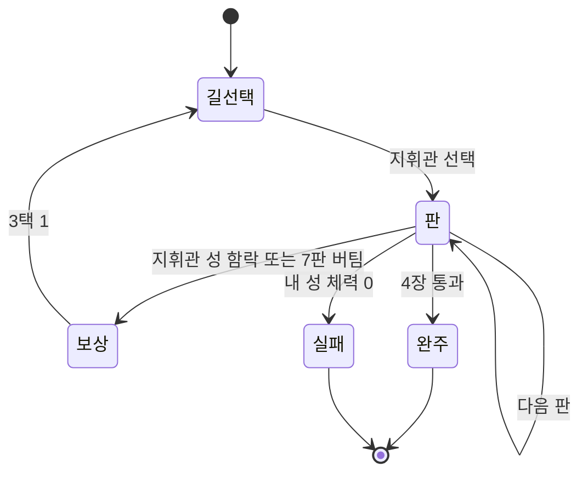

# 게임 디자인 문서

- 제품명: Three Purses. 작업 id `send-lane-duel`
- 문서 상태: approved
- 소유자: syous
- 버전/수정일: v0.1 / 2026-10-06
- Source of truth: 핵심 계약. 런·판·전투·경제·지휘관·보상·일일 도전의 규칙과 상수. 상수 원장은 `data/core/rules.json`, 콘텐츠 원장은 `data/content/*.json`, 참조 구현은 `tools/sim/run_sim.py`
- Depends on: `00-product-brief.md` v0.1, `01-research-dossier.md` v0.1, `../policy-review.md`
- Open blockers: Core 사람 플레이테스트, 대표 화면 방향 선택, 실기기·SDK·출시 검수
- 승인 근거: 2026-10-06 사용자 전체 제작 승인 및 구현 계획 실행 요청

이름은 모두 중립 가칭이다. 세계관이 정해지면 `name_ko`·`name_en` 만 바꾸고 id 와 수치는 유지한다.

## 경험 타임라인

| 시점 | 화면 | 플레이어의 행동과 결과 |
| --- | --- | --- |
| 0~10초 | 원정(SCR-003) | 튜토리얼이 손가락으로 빈 자리를 가리킨다. 저격대를 놓으면 웨이브가 들어오고 막힌다 |
| 10초~3분 | 원정 | 일꾼 사기 → 다음 판 금화가 늘어난 것을 본다 → 용병을 보내 지휘관 성이 깎이는 것을 본다 → 지휘관이 보낸 용병이 내 레인으로 온다 |
| 3~10분 | 원정·보상·길 선택 | 1장 지휘관을 깨고 보상 3택 1, 다음 지휘관 둘 중 하나를 고른다. 2~3장에서 첫 런이 끝난다 |
| 30분 | 정산·도감 | 3~4런. 지휘관 2~3종의 성향을 도감에서 확인하고 길 선택에 쓴다 |
| 7일 | 일일 도전·편성 | 편성 4종, 격 1~3, 일일 도전 순위 |

## 코어 루프

한 판의 결정은 하나다. **이번 판 금화를 방어 유닛, 일꾼, 용병에 얼마씩 쓸 것인가.** 지휘관의 방어는 보이고, 지휘관이 보낼 용병은 전투가 시작돼야 드러난다.

## 규칙과 상태 머신

### 런의 상태

참조 구현은 `tools/sim/run_sim.py` 의 `Run` 클래스다. 상태 이름은 `route`, `round`, `draft`, `won`, `lost`.

### 상수 (원장: `data/core/rules.json`)

| 상수 | 값 | 키 |
| --- | --- | --- |
| 장 수 / 장마다 최대 판 수 | 4 / 7 | `run.chapters`, `run.rounds_per_chapter` |
| 내 성 체력 / 장을 넘길 때 회복 | 26 / 3 | `run.player_castle_hp`, `run.heal_between_chapters` |
| 자리 수 | 6 | `run.slots` |
| 시작 금화 / 기본 수입 | 20 / 12 | `run.start_gold`, `run.base_income` |
| 일꾼 값 / 일꾼 수입 / 한도 | 10 / 판마다 +3 / 10명 | `economy.*` |
| 용병 묶음을 살 때 수입 | 묶음마다 판마다 +1 | `economy.merc_income_per_pack` |
| 교체 환급 | 쓴 금화의 50% | `economy.replace_refund_pct` |
| 전투 박자 | 8 | `combat.beats` |
| 상성 배율 | 강함 1.5 / 보통 1.0 / 약함 0.6 | `combat.mult_*` (10 배 정수) |
| 시간 초과 성 피해(장 1~4) | 8 / 10 / 12 / 14 | `run.timeout_castle_damage` |
| 일찍 깬 전리품 | 아낀 판마다 금화 12 | `run.early_clear_gold_per_round` |
| 포로 | 막아 낸 용병 묶음 2개마다 1묶음 | `capture.blocked_packs_per_captive` |
| 지휘관 성 체력(장 1~4) | 14 / 18 / 22 / 26 | `commander.castle_hp` |
| 지휘관 수입 배율(장 1~4) | 104 / 118 / 132 / 146% | `commander.income_pct` |

모든 계산은 정수다. 나눗셈은 내림이다.

### 한 판의 순서

1. **수입**: 내 금화 += 수입(런의 첫 판은 시작 금화만). 지휘관도 같다.
2. **지휘관 결정**: 지휘관이 성향표대로 금화를 방어·일꾼·용병으로 나눈다. 방어와 일꾼은 바로 반영되어 보인다. 용병 묶음 목록은 숨겨진다. 지휘관은 내 **직전 판 끝의 진영**만 본다.
3. **정찰과 배분**: 플레이어가 유닛 배치·강화·교체, 일꾼, 용병 묶음을 정한다. 금화는 남겨도 된다(다음 판으로 이월).
4. **전투**: 두 레인이 동시에 싸운다.
   - 내 레인에 들어오는 적: 이번 판 웨이브 → 지휘관의 용병(보낸 순서)
   - 지휘관 레인에 들어오는 적: 같은 웨이브 → 내 포로(공짜) → 내가 산 용병(순서대로)
5. **정산**: 샌 적의 피해 합만큼 성 체력이 깎인다. 포로를 정한다. 용병을 산 만큼 수입이 오른다. 지휘관이 보낸 용병이 공개되어 기록에 남는다.
6. **판정**(순서대로)
   - 내 성 체력 0 이하 → 런 실패
   - 지휘관 성 체력 0 이하 → 장 통과. 아낀 판마다 금화 12, 성 체력 +3
   - 7번째 판이었다 → 시간 초과. 내 성 체력에서 장별 피해(8/10/12/14)를 뺀다. 0 이하면 런 실패, 남으면 회복 없이 장 통과
   - 아니면 다음 판

### 전투 규칙 (`resolve`)

- 적은 한 줄로 선다. 각 적은 방어 속성, 체력, 샐 때 주는 성 피해를 가진다.
- 박자 8번을 진행한다. 박자마다 자리 0번부터 순서대로 유닛이 공격한다.
  - 단일형(`single`): 살아 있는 맨 앞 적을 `hits` 번 친다. 한 번 칠 때마다 맨 앞을 다시 찾는다. 남는 피해는 버린다.
  - 범위형(`splash`): 앞에서부터 살아 있는 적 `targets` 명을 한 번씩 친다.
  - 피해 = 유닛 피해 × 상성 배율(15/10/6) ÷ 10, 내림, 최소 1.
- 박자가 끝났을 때 살아 있는 적은 체력이 깎였어도 모두 샌다.
- 용병 묶음의 모든 적이 죽었으면 그 묶음은 "막아 냈다".
- 자리의 위치는 공격 순서만 정한다. 출시 범위에 위치 보너스는 없다(DEC-013).

상성표

| 공격 속성 | 강한 상대(×1.5) | 약한 상대(×0.6) |
| --- | --- | --- |
| 관통 `pierce` | 중갑 `plate` | 경갑 `light` |
| 폭발 `blast` | 경갑 `light` | 외피 `hide` |
| 베기 `slash` | 외피 `hide` | 결계 `ward` |
| 마력 `arcane` | 결계 `ward` | 중갑 `plate` |

### 웨이브 (`make_wave`)

- 런 전체 판 번호 r(0~27)의 체력 예산 H(r): 36 에서 시작해 판마다 ×110÷100(내림). H(0)=36, H(7)=66, H(14)=124, H(21)=236, H(27)=414.
- 장마다 웨이브의 방어 속성 하나가 정해진다(길 선택 때 보인다).
- 장 안의 판 k(0~6) 형태: 무리, 무리, 혼합, 정예, 무리, 혼합, 우두머리.

| 형태 | 구성 | 샐 때 성 피해 |
| --- | --- | --- |
| 무리 | (8 + 2k)기, 한 기 체력 = H ÷ 수(올림) | 기마다 1 |
| 정예 | (2 + k÷3)기, 한 기 체력 = H ÷ 수(올림) | 기마다 3 |
| 혼합 | 무리 절반(예산 절반) 뒤에 정예 절반(올림, 남은 예산) | 1 / 3 |
| 우두머리 | 1기, 체력 H | 8 |

### 포로

지휘관의 용병 묶음 중 막아 낸 것을 보낸 순서대로 세어, 짝수 번째(2번째, 4번째, 6번째) 묶음이 포로가 된다. 포로는 다음 판에 같은 종류로 **공짜로, 자동으로** 지휘관 레인에 보내진다. 편성에 없는 종류도 보낸다. 장이 바뀌면 포로는 사라진다.

### 지휘관 (원장: `data/content/commanders.json`, 상세: `../systems/commanders.md`)

| 지휘관 | 금화 배분 [방어, 일꾼, 용병] % | 용병 고르는 법 |
| --- | --- | --- |
| 철벽 | 70 / 20 / 10 | 장 시작 때 정한 한 종류 |
| 돌격 | 35 / 5 / 60 | 한 종류 |
| 욕심 | 1~2판 30 / 70 / 0, 이후 30 / 0 / 70 | 한 종류 |
| 변덕 | 50 / 10 / 40 | 방어 속성을 판마다 다음 것으로, 무리와 정예를 번갈아 |
| 역습 | 55 / 15 / 30, 성이 깎인 다음 판은 40 / 0 / 60 | 한 종류 |
| 저격 | 55 / 15 / 30 | 내 직전 판 진영에 3묶음을 보냈을 때 가장 아픈 종류 |

지휘관은 장 시작 때 방어 계열 2개와 즐겨 쓰는 용병 1종을 난수로 정하고, 시작 예산(20/60/120/200)으로 진영을 짓고 일꾼(0/2/4/6)을 가진다. 방어 예산은 자리 4개까지 채우기를 먼저 하고 그다음 가장 낮은 단계를 강화한다.

## 진행

런 안

- **길 선택**: 장마다 지휘관 후보 2명 중 하나를 고른다. 후보마다 성향, 방어 계열, 시작 진영, 장의 웨이브 속성이 보인다.
- **장 보상**: 장을 통과하면 3택 1. 후보는 편성에 없는 방어 계열, 편성에 없는 용병, 아직 안 나온 증표에서 뽑는다.
- **출정 편성**: 런을 시작할 때 방어 계열 2 + 용병 2 묶음을 고른다(4종, `data/content/draft.json`).

런 밖

- **훈장**: 통과한 장마다 3, 완주 6, 일일 도전 첫 제출 5. 편성 해금(30/60/100)과 깃발 꾸미기에 쓴다. 런 안의 힘은 사지 못한다.
- **격**: 완주하면 다음 격이 열린다(0~5). 격마다 지휘관 수입 +12%, 지휘관 성 체력 +2.
- **도감**: 만난 지휘관의 성향표, 유닛·용병·증표 설명이 열린다.

## 경제

| 쓰는 곳 | 값 | 돌아오는 것 |
| --- | --- | --- |
| 유닛 1단계 | 10 | 계열별 피해(아래 표) |
| 강화 2단계 / 3단계 | 14 / 22 | 누적 금화당 피해가 단계가 오를수록 좋아진다(자리 6칸의 압박) |
| 교체 | 새 유닛 10 − 환급 50% | 계열 전환 |
| 일꾼 | 10 | 판마다 +3(4판째부터 이득) |
| 용병 묶음 | 8 | 지휘관 성 피해 + 판마다 수입 +1 |

유닛 (원장: `data/content/units.json`)

| 계열 | 공격 | 방식 | 피해 1 / 2 / 3단계 |
| --- | --- | --- | --- |
| 저격대 | 관통 | 단일 1회 | 7 / 18 / 40 |
| 포격대 | 폭발 | 범위 3명 | 2 / 5 / 11 |
| 돌격대 | 베기 | 단일 2회 | 3 / 8 / 18 |
| 주술대 | 마력 | 범위 2명 | 3 / 8 / 17 |

용병 (원장: `data/content/mercenaries.json`): 방어 속성 4 × 형태 2 = 8종. 무리는 6기·체력 5·피해 1, 정예는 1기·체력 36·피해 4. 값은 모두 8.

단일형은 정예와 우두머리에, 범위형은 무리에 강하다. 그래서 지휘관의 방어가 범위형 위주면 정예를, 단일형 위주면 무리를 보내는 것이 기본 읽기다.

## 콘텐츠

| 종류 | 출시 수량 | 원장 |
| --- | --- | --- |
| 방어 계열 × 단계 | 4 × 3 | `units.json` |
| 용병 | 8 | `mercenaries.json` |
| 지휘관 | 6 | `commanders.json` |
| 증표 | 10 | `draft.json` |
| 출정 편성 | 4 | `draft.json` |
| 격 | 0~5 | `rules.json` |

증표: 성 체력 +6, 수입 +2, 일꾼 값 −2, 자리 +1, 막아 낸 묶음마다 포로, 용병 값 −1, 장 시작 금화 +15, 내 레인 박자 +1, 강화 값 −3, 장마다 첫 성 피해 +3.

## 온보딩

첫 런의 1장이 체험형 튜토리얼이다. 글 대신 손가락 표시와 강조로 가르친다.

| 판 | 가르치는 것 | 강제하는 행동 |
| --- | --- | --- |
| 1 | 유닛을 놓으면 웨이브를 막는다 | 저격대 1개 배치 |
| 2 | 일꾼을 사면 다음 판 금화가 는다 | 일꾼 1명 |
| 3 | 용병을 보내면 지휘관 성이 깎인다 | 용병 1묶음 |
| 4 | 지휘관도 용병을 보낸다. 정산 화면에서 무엇이 샜는지 본다 | 없음(자유) |
| 5~ | 자유. 튜토리얼 지휘관은 '철벽', 성 체력 10 고정 | 없음 |

튜토리얼 중에는 어떤 광고도 나오지 않는다. 건너뛰기는 설정에서 가능하다.

## 수익화

전면 광고가 주 수익이고 보상형 광고가 보조다. 결제 상품은 없다(DEC-003, DEC-024, DEC-025). 원장은 `data/monetization/bm-profile.json`, 표는 `05-economy-content-liveops.md` 의 생성 블록.

| 배치 | 형식 | 언제 | 내용 | 제한 |
| --- | --- | --- | --- | --- |
| 장 사이·런 사이 | 전면 | 장 보상을 고른 직후(길 선택 전), 런 정산을 닫고 본진으로 갈 때 | 건너뛸 수 있는 광고 | 두 번째 세션부터, 120초 간격, 세션 3회, 하루 8회 |
| 정산 훈장 2배 | 보상형 | 런 정산 화면 | 이번 런 훈장 ×2 | 세션 1회, 하루 6회 |
| 이어하기 | 보상형 | 원정에서 런 실패 직후 | 성 체력 8 로 실패한 판을 다시 시작 | 런당 1회, 세션 1회, 하루 4회. 일일 도전에서는 없음 |

전면 광고가 나오지 않는 곳: 판 도중과 전투 중, 튜토리얼, 앱 실행 직후, 첫 세션, 보상형 광고를 본 직후의 휴지. 4장 뒤에는 보상 단계가 없으므로 런 정산을 닫을 때 한 번만 나온다. 일일 도전에서도 같은 규칙으로 나온다(결과에 영향이 없다).

결제 상품은 없다. 금화·용병·유닛·성 체력도, 광고 제거도 팔지 않는다.

## 소셜 또는 오프라인 경계

- 원정은 완전 오프라인으로 동작한다. 저장은 기기에 먼저 쓰고, 연결되면 Firestore 에 백업한다.
- 일일 도전의 시드는 날짜(UTC)에서 계산하므로 오프라인에서도 플레이할 수 있다. 제출과 순위 조회만 연결이 필요하다. 오프라인으로 끝낸 기록은 그날(UTC) 안에 연결되면 제출된다.
- 닉네임은 순위표에만 쓰인다. 채팅, 친구, 길드는 없다.

일일 도전 규칙

- 편성은 그날 지정된 것 하나, 격 0, 증표 해금 차이 없음. 길 선택과 보상 후보는 시드로 고정된다.
- 하루 첫 시도만 기록된다. 이후는 연습이다.
- 점수 = 통과한 장 × 1000 + 남은 성 체력 × 10 + 완주 시 아낀 판 × 50. 동점은 쓴 판이 적은 쪽, 남은 금화가 많은 쪽, 먼저 제출한 쪽 순이다.
- 이어하기 보상형 광고는 없다. 전면 광고는 원정과 같은 규칙으로 나온다. 순위 보상은 없고 참여 훈장 5만 준다.

## 저장과 리셋 계약

| 데이터 | 저장 시점 | 리셋 |
| --- | --- | --- |
| 진행 중인 런(시드, 상태, 행동 기록) | 판 정산마다, 길 선택·보상 직후 | 런 종료 시 삭제. 앱이 꺼져도 판 시작 시점으로 복귀 |
| 훈장, 해금, 격, 도감 | 변경 즉시 | 계정·데이터 삭제 때만 |
| 일일 도전 기록 | 제출 시 | UTC 자정에 새 날 |
| 설정 | 변경 즉시 | 없음 |

런은 시드와 행동 기록만 있으면 처음부터 다시 계산해 같은 상태가 된다. 저장 형식은 `06-technical-production-plan.md`.

## 인수 시나리오

| ID | 시나리오 | 기대 결과 |
| --- | --- | --- |
| AC-001 | `tests/fixtures/vectors.json` 의 전투 벡터 60건을 구현체의 전투 함수에 넣는다 | 성 피해, 막아 낸 묶음 번호, 남은 체력 합이 모두 일치 |
| AC-002 | 런 벡터 40건의 시드·편성·격·행동 기록을 재생한다 | 판마다 금화·성 체력·지휘관 성 체력·상태, 최종 점수가 모두 일치 |
| AC-003 | 금화보다 비싼 행동, 편성에 없는 용병, 일꾼 한도 초과를 시도한다 | 거부되고 상태가 변하지 않는다 |
| AC-004 | 판 도중 앱을 강제 종료하고 다시 연다 | 그 판의 배분 단계 처음으로 돌아온다. 금화·진영·포로가 정산 직후와 같다 |
| AC-005 | 비행기 모드에서 원정 한 런을 끝낸다 | 오류 없이 정산까지 진행. 광고 버튼은 숨겨진다 |
| AC-006 | 7번째 판까지 지휘관 성을 못 깼고 내 성 체력이 시간 초과 피해보다 많다 | 피해를 받고 회복 없이 보상 단계로 간다 |
| AC-007 | 지휘관이 3묶음을 보냈고 모두 막았다 | 다음 판에 2번째 묶음과 같은 종류 1묶음이 공짜로 나간다 |
| AC-008 | 일일 도전에서 실패한다 | 이어하기 광고가 제안되지 않는다 |
| AC-009 | 같은 날 일일 도전을 두 번 끝낸다 | 첫 점수만 순위표에 있다 |
| AC-010 | 첫 세션에서 한 런을 끝까지 한다 | 전면 광고가 한 번도 나오지 않는다 |
| AC-011 | 두 번째 세션에서 장 보상을 고른다 | 길 선택 전에 전면 광고가 나온다. 5초 안에 닫기가 나오고 뒤로 가기로 닫힌다. 닫으면 길 선택이 그대로 이어진다 |
| AC-012 | 전면 광고를 본 뒤 120초 안에 다음 장을 끝낸다. 한 세션에 네 번째 휴지에 도달한다 | 두 경우 모두 전면 광고가 나오지 않는다 |
| AC-013 | 판 도중·전투 중·튜토리얼 중 어느 시점에서도 | 전면 광고가 나오지 않는다 |

## 열린 문제

| ID | 문제 | 근거 | 다음 확인 |
| --- | --- | --- | --- |
| OP-01 | 내 방어 계열이 장의 웨이브 속성에 강해도 장 실패율이 낮아지지 않는다 | `docs/07-qa/evidence/run-sim.json` 상성별 실패율: 유리 16.6%, 불리 14.8%(균형 봇) | 실패의 대부분이 웨이브가 아니라 지휘관 용병에서 온다. 웨이브 비중을 키우거나 속성을 판마다 섞는 안을 Core Gate 에서 검산 |
| OP-02 | 정답을 아는 봇은 격 0 을 100% 완주한다 | 같은 파일 | 격 곡선을 사람 테스트로 다시 맞춘다 |
| OP-03 | 자리 위치가 순서 외에 의미가 없다 | DEC-013 | 인접 보너스 등은 Core Gate 뒤 검토 |

## 구현 승인 반영 — 2026-10-06

제품 계약은 승인되었습니다. 현재 실행 원장은 이 문서와 `../../02-decisions/ADR-001-approved-product.md`입니다. 이름 Three Purses, 태엽 장난감 세계관, Android/iOS, 영어/한국어, 타깃 20~40대, 소프트론칭 캐나다·호주·한국, AdMob·Poing, 순위표 지연 검수로 확정했습니다. 과거 초안의 미확정 표기는 위 결정으로 대체됩니다. 아트 시안 선택·사람 테스트·실기기·마켓 확인은 별도 미완료 증거입니다.
