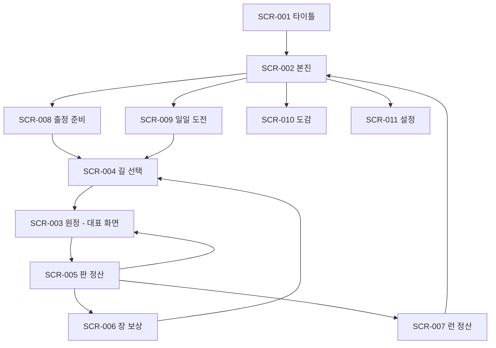

# UI UX 명세

- 제품명: Three Purses. 작업 id `send-lane-duel`
- 문서 상태: approved
- 소유자: syous
- 버전/수정일: v0.1 / 2026-10-06
- Source of truth: 내비게이션, 화면 계약 SCR-###, 상태, 피드백, 접근성, 첫 세션
- Depends on: `02-gdd.md` v0.1, `04-art-audio-bible.md` v0.1
- Open blockers: Core 사람 플레이테스트, 대표 화면 방향 선택, 실기기·SDK·출시 검수
- 승인 근거: 2026-10-06 사용자 전체 제작 승인 및 구현 계획 실행 요청

원칙: 화면마다 목적 하나와 가장 강조하는 행동 하나. 설명은 글보다 그림·수치·실제 예시. 터치 영역은 Android 48×48dp, iOS 44×44pt 이상(POL-100, POL-102). 상·하단은 안전 영역 안에 둔다(POL-103, POL-104).

## 내비게이션 그래프

뒤로 가기: 원정 중에는 일시정지 시트(계속, 설정, 런 포기)를 연다. 그 밖에는 이전 화면.

## 디자인 시스템

| 토큰 | 값 | 쓰임 |
| --- | --- | --- |
| 기준 캔버스 | 360×640dp 논리 화면, 세로 고정 | Godot `canvas_items` 늘리기, 가로는 중앙 기둥 |
| 여백 단위 | 8dp | 간격 8/16/24 |
| 글자 | 제목 22, 본문 16, 수치 20(고정폭 숫자), 보조 13. 최소 13 | 큰 글자 설정 +15% 까지 배치 유지 |
| 속성 표시 | 색 + 모양 + 한 글자 기호 | 관통 ▲, 폭발 ●, 베기 ◆, 마력 ★ / 중갑 ■, 경갑 ○, 외피 ◇, 결계 ☆ |
| 상성 표시 | 강함 위 화살표 2개, 약함 아래 화살표 1개 | 색에만 의존하지 않는다 |
| 주 행동 버튼 | 높이 56dp, 화면 하단 중앙, 한 화면에 하나 | "출전" |
| 금화 | 숫자 + 동전 아이콘, 쓸 때 예상 잔액을 함께 표시 | 배분 막대 |

색·형태·질감은 세계관 선택 뒤 `04-art-audio-bible.md` 에서 정한다.

## 화면 계약

### SCR-003 원정 (대표 화면)

- 목적: 이번 판 금화를 세 갈래로 나누고 전투를 본다.
- 가장 강조하는 행동: 하단 "출전".
- 진입: 길 선택 뒤, 판 정산 뒤. 이탈: 전투 종료 → SCR-005.
- 시선 순서: ① 지휘관 진영(위) ② 내 진영(가운데 아래) ③ 세 갈래 배분(아래) ④ 출전.

레이아웃(위에서 아래로)

| 구역 | 높이 | 내용 |
| --- | --- | --- |
| 상단 띠 | 48dp | 장·판(예: 2장 3/7), 지휘관 성 체력 막대, 일시정지 |
| 지휘관 진영 | 22% | 지휘관 초상과 성향 아이콘, 자리 6칸의 유닛(계열 기호와 단계 점), 일꾼 수. 전투 전에는 "보낼 용병 ?" 표시 |
| 레인 | 26% | 좌우 두 줄. 왼쪽은 내 레인(적이 위에서 내려옴), 오른쪽은 지휘관 레인(내 용병이 올라감). 이번 판 웨이브 미리보기(형태 아이콘 × 수, 방어 속성 기호) |
| 내 진영 | 20% | 자리 6칸. 빈 자리 탭 → 계열 선택, 유닛 탭 → 강화·교체. 내 성 체력 막대 |
| 배분 패널 | 22% | 세 칸: 지키기(이번 판 쓴 금화), 키우기(일꾼 + −, 다음 판 수입 미리보기), 보내기(편성 용병 카드 + −, 포로 표시). 남은 금화 |
| 주 행동 | 56dp | "출전". 금화가 남으면 "금화 n 남김" 보조 문구 |

- 예상 표시: 유닛을 놓거나 용병을 고르면 "웨이브 기준 예상 누수 n"과 "지휘관 성 예상 피해 n"을 갱신한다. 지휘관의 숨은 용병은 계산에 넣지 않고 "+ ?"로 표시한다.
- 전투 중: 박자마다 0.35초(2배속 0.18초). 건너뛰기 버튼. 샌 적은 성으로 날아가 체력 막대를 깎는다.
- 분석 이벤트: `round_start`, `round_resolved`.
- 인수 화면: 배분 중 / 전투 중 / 일시정지 3장.

### SCR-004 길 선택

- 목적: 다음 지휘관을 고른다. 강조 행동: 카드 하나를 고르고 "이 길로".
- 카드 2장 세로 배치. 카드마다 지휘관 초상, 성향 한 줄과 아이콘, 방어 계열 2개 기호, 시작 진영 미니 보기, 장의 웨이브 속성, 내 용병별 "잘 통함 / 보통 / 막힘" 아이콘.
- 도감에서 아직 못 본 지휘관은 성향 한 줄만 보인다.
- 이벤트: `route_chosen`.

### SCR-005 판 정산

- 목적: 무엇이 샜고 왜인지 본다. 강조 행동: "다음 판".
- 위: 지휘관이 보낸 용병 공개(아이콘 × 수). 가운데: 내 레인에서 샌 적과 성 피해, 지휘관 레인에서 샌 내 용병과 성 피해. 아래: 포로 n, 다음 판 수입.
- 성 피해가 있으면 "가장 많이 샌 적 → 그 적에 약했던 내 유닛"을 그림 한 줄로 보여 준다.
- 3초 뒤 자동 진행(설정에서 끔). 이벤트: `round_resolved` 의 파라미터로 기록.

### SCR-006 장 보상

- 목적: 보상 하나를 고른다. 강조 행동: 카드 선택.
- 카드 3장. 종류 표시(방어 계열 / 용병 / 증표), 효과 한 줄, 수치.
- 이벤트: `draft_picked`.

### SCR-007 런 정산

- 목적: 결과를 확인하고 다음 행동으로 간다. 강조 행동: "다시 출정"(일일 도전은 "순위 보기").
- 통과한 장, 만난 지휘관 초상과 결과, 훈장 합계, 새로 열린 도감·격.
- 실패 시 원인 그림 한 줄(SCR-005 와 같은 형식).
- 광고 버튼: "광고 보고 훈장 2배(+n)". 원정 실패 직후에는 이 화면 앞에 이어하기 시트("광고 보고 성 체력 8 로 이 판 다시")가 한 번 뜬다.
- 이벤트: `run_end`, `ad_*`.

### SCR-001·002·008·009·010·011

- SCR-001 타이틀: 로고, 실제 초기화 진행 표시(저장 불러오기, 원격 설정), "시작". 초기화 실패 시 오프라인으로 진입한다.
- SCR-002 본진: 가운데 큰 "출정". 위에 일일 도전 카드(남은 시간, 내 순위), 아래에 도감·설정. 진행 중인 런이 있으면 "이어서 출정"이 주 행동이 된다.
- SCR-008 출정 준비: 편성 4장 가로 넘김(잠긴 것은 훈장 값), 격 선택. 주 행동 "출정".
- SCR-009 일일 도전: 오늘의 편성, 남은 시간, 규칙 아이콘 3개(하루 첫 시도만, 이어하기 없음, 모두 같은 조건), 상위 100 과 내 순위. 주 행동 "도전"(이미 했으면 "연습").
- SCR-010 도감: 탭 4개(지휘관, 유닛, 용병, 증표). 지휘관은 판별 금화 배분을 막대 그림으로 보여 준다.
- SCR-011 설정: 소리, 진동, 전투 속도, 자동 진행, 큰 글자, 색약 보조, 언어, 개인정보 옵션, 개인정보 처리방침, **계정·데이터 삭제**, 튜토리얼 다시 보기.

### 전면 광고

- 전면 광고는 화면이 아니라 두 전환 사이에 끼어든다: SCR-006 보상 선택 → (전면) → SCR-004, SCR-007 닫기 → (전면) → SCR-002.
- 광고가 준비되지 않았으면 기다리지 않고 바로 다음 화면으로 간다. 광고를 닫으면 멈췄던 자리에서 이어진다.
- 결제 화면은 없다.
- 이벤트: `ad_impression`(format=interstitial).

## 상태 매트릭스

| 구성요소 | 기본 | 눌림 | 선택 | 비활성 | 잠김 | 로딩 | 빈 상태 | 오류·오프라인 | 완료 |
| --- | --- | --- | --- | --- | --- | --- | --- | --- | --- |
| 자리 칸 | 유닛과 단계 점 | 0.96 축소 | 테두리 강조 + 행동 시트 | 전투 중 회색 | 증표로 열리는 7번째 칸 자물쇠 | 없음 | 점선과 + | 없음 | 강화 반짝 |
| 용병 카드 | 아이콘·값·수 | 축소 | 수량 배지 | 금화 부족 회색 + 값 빨강 | 편성에 없음(보상에서만) | 없음 | 포로 없음은 칸 숨김 | 없음 | 출전 시 레인으로 날아감 |
| 출전 버튼 | 강조색 | 눌림 | 없음 | 전투 중 숨김 | 튜토리얼 강제 행동 전 회색 | 없음 | 없음 | 없음 | 없음 |
| 보상형 광고 버튼 | 보상 문구 | 눌림 | 없음 | 한도 도달 시 숨김 | 튜토리얼 숨김, 일일 도전은 이어하기만 숨김 | 불러오는 중 표시 | 광고 없음은 숨김 | 실패: 보상 없이 닫고 한 번 재시도 제안 | 지급 알림 |
| 순위 목록 | 100행 | 없음 | 내 행 강조 | 없음 | 없음 | 뼈대 행 | "아직 기록이 없어요" | 오프라인: 마지막으로 받은 목록 + 안내 | 제출됨 배지 |
| 길 카드 | 정보 전체 | 축소 | 테두리 + 버튼 활성 | 없음 | 못 본 지휘관은 성향만 | 없음 | 없음 | 없음 | 없음 |

## 피드백과 게임 필

| ID | 계기 | 즉시 반응 | 인과 표시 | 소리 | 진동 | 길이 | 움직임 줄이기 |
| --- | --- | --- | --- | --- | --- | --- | --- |
| FX-PLACE | 유닛 배치 | 칸에 내려앉음 | 예상 누수 수치 감소 | 탁 | 약 | 150ms | 즉시 표시 |
| FX-HIT | 공격 적중 | 적 흔들림, 상성 화살표 | 강함은 큰 숫자, 약함은 작은 회색 숫자 | 속성별 타격음 | 없음 | 박자 안 | 숫자만 |
| FX-LEAK | 적이 샘 | 적이 성으로 돌진 | 성 체력 막대가 그 자리에서 깎임 | 낮은 충돌음 | 중 | 300ms | 막대만 |
| FX-SEND | 용병 출전 | 카드가 지휘관 레인으로 | 수입 +n 표시 | 나팔 짧게 | 약 | 250ms | 즉시 |
| FX-REVEAL | 지휘관 용병 공개 | "?"가 뒤집힘 | 내 레인에 합류 | 북 | 약 | 400ms | 교체만 |
| FX-CAPTURE | 포로 획득 | 막아 낸 묶음이 내 쪽으로 | 포로 칸에 쌓임 | 사슬 소리 | 약 | 300ms | 즉시 |
| FX-BREACH | 지휘관 성 함락 | 성 무너짐 | 전리품 금화 튀어나옴 | 팡파르 | 강 | 900ms | 한 장면 |
| FX-FALL | 내 성 함락 | 화면 어두워짐 | 원인 그림으로 전환 | 낮은 음 | 중 | 700ms | 전환만 |

## 접근성

| 장벽 | 대상 | 기본 지원 | 설정 | 검수 |
| --- | --- | --- | --- | --- |
| 색각 | 속성 8종, 상성 | 색 + 모양 + 기호 | 기호 크게 | 색약 필터 화면 캡처 |
| 저시력 | 수치, 값 | 최소 13, 대비 4.5:1 이상 | 큰 글자 +15% | 최소 화면 캡처 |
| 운동 | 작은 칸, 빠른 입력 | 시간 제한 없음, 터치 48dp, 끌기 없이 탭만으로 조작 | 자동 진행 끔 | 한 손 엄지 도달 범위 확인 |
| 전정 | 흔들림, 번쩍임 | 화면 흔들림 없음 | 움직임 줄이기 | 설정 켠 화면 녹화 |
| 청각 | 소리 신호 | 모든 신호에 시각 표시 | 진동 세기 | 무음 플레이 |
| 인지 | 숨은 규칙 | 도감의 그림 설명, 예상 수치 | 튜토리얼 다시 보기 | 처음 보는 사람 5명 관찰 |

## 반응형 기기 매트릭스

| 구분 | 기준 | 확인 항목 |
| --- | --- | --- |
| 최소 | 360×640dp | 자리 6칸과 배분 패널이 겹치지 않음, 글자 13 유지 |
| 대표 | 390×844pt(노치) | 상단 띠가 안전 영역 아래 |
| 긴 화면 | 21:9 | 남는 높이는 레인 구역에 준다 |
| 태블릿·폴더블 | 가로가 넓음 | 세로 기둥 중앙, 양옆은 배경 |
| Android 끝까지 그리기 | targetSdk 36 | 시스템 바·제스처 영역과 하단 버튼이 겹치지 않음(POL-104) |

## 첫 세션 스토리보드

| 시간 | 화면 | 일어나는 일 |
| --- | --- | --- |
| 0:00 | SCR-001 | 초기화 뒤 바로 튜토리얼 원정으로 들어간다(본진을 건너뜀) |
| 0:05 | SCR-003 | 손가락이 빈 자리를 가리킨다. 저격대를 놓으면 "출전"이 켜진다 |
| 0:20 | SCR-003 | 웨이브가 막힌다. 금화가 들어온다 |
| 0:40 | SCR-003 | 손가락이 일꾼 +를 가리킨다. 다음 판 수입 숫자가 커진다 |
| 1:10 | SCR-003 | 손가락이 용병 카드를 가리킨다. 지휘관 성이 처음 깎인다 |
| 1:45 | SCR-005 | 지휘관의 용병이 공개되고 내 레인에서 하나가 샌다. 원인 그림 |
| 3:30 | SCR-006 | 1장 통과. 보상 3택 1 |
| 3:50 | SCR-004 | 지휘관 둘 중 하나 선택. 여기부터 자유 |
| 8:00 | SCR-007 | 첫 런 종료. 훈장, 도감 한 칸. "다시 출정" |
| 8:20 | SCR-002 | 본진이 처음 보인다. 일일 도전 카드는 두 번째 런 뒤에 열린다. 첫 세션에는 전면 광고가 없다 |

## UI 인수 증거

- 대표 화면 SCR-003 의 목표 시안과 실제 실행 화면을 같은 해상도로 나란히 비교한 그림(배분 중, 전투 중).
- 최소·대표·긴 화면 3종에서 SCR-003~007 실행 캡처.
- 큰 글자, 색약 보조, 움직임 줄이기를 켠 캡처.
- 오프라인 상태의 SCR-007(광고 버튼 숨김)과 SCR-009(마지막 목록 + 안내).
- 두 번째 세션의 전면 광고 전후 전환 녹화(닫기 버튼, 뒤로 가기, 복귀 화면).
- 첫 세션 스토리보드 전 구간 녹화 1개.

빌드 성공이나 캡처 생성만으로 UI 완료를 주장하지 않는다. 목표와 비교해 고친 기록을 남긴다.

## 구현 승인 반영 — 2026-10-06

제품 계약은 승인되었습니다. 현재 실행 원장은 이 문서와 `../../02-decisions/ADR-001-approved-product.md`입니다. 이름 Three Purses, 태엽 장난감 세계관, Android/iOS, 영어/한국어, 타깃 20~40대, 소프트론칭 캐나다·호주·한국, AdMob·Poing, 순위표 지연 검수로 확정했습니다. 과거 초안의 미확정 표기는 위 결정으로 대체됩니다. 아트 시안 선택·사람 테스트·실기기·마켓 확인은 별도 미완료 증거입니다.
