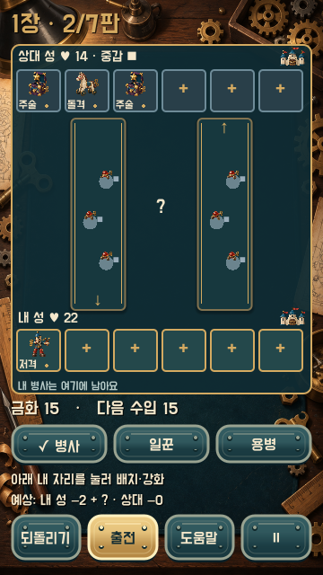
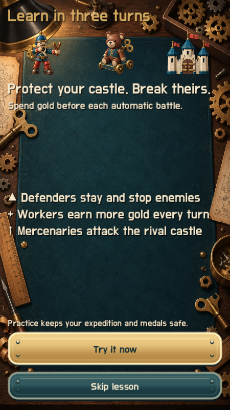
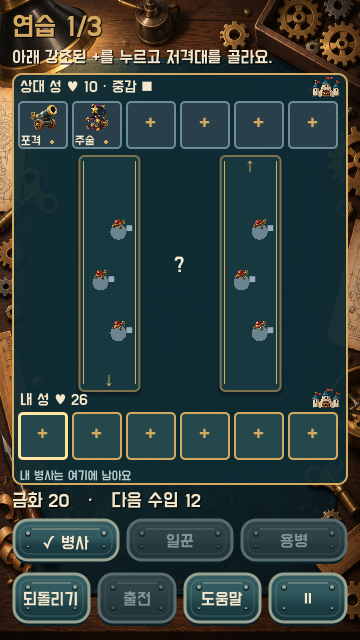
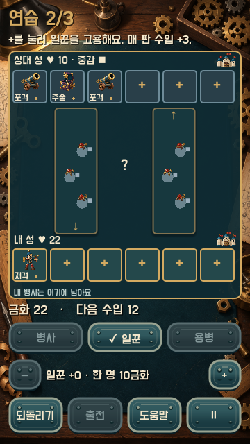
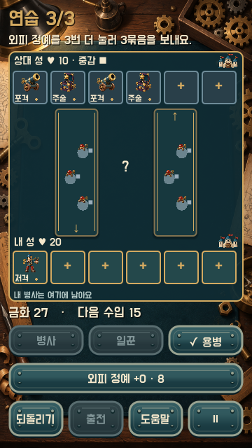
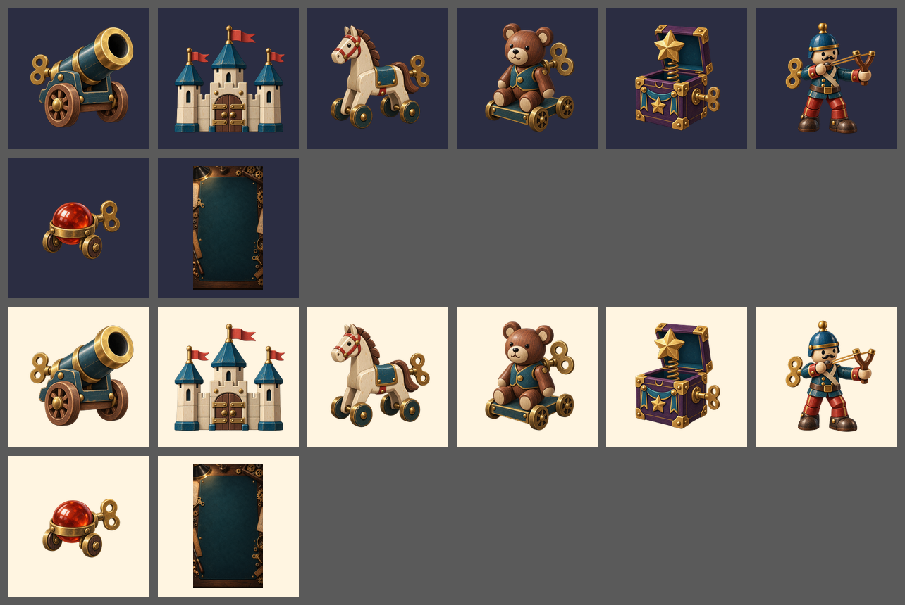

# 플레이 빌드 실행 화면 검수

확인일: 2026-10-07. 사용자의 “게임으로 만든 후에 다시 볼게” 요청에 따라 회색 상자에서 제품 아트·움직임·소리·직접 조작하는 안내를 적용했다. B 작업대의 청록·황동·나무 재질을 구현 기준으로 삼았다. 사용자 시각 승인·재미 검증은 보류 상태다.

## 동일한 실제 상태의 전후 비교

한국어 큰 글자, 360×640, 동일한 참조 런의 1장 2판 배치 화면을 비교했다. 상대 성 14, 내 성 22, 금화 15, 다음 수입 15 상태다.

| 적용 전 | 적용 후 |
| --- | --- |
|  |  |

기존 글자·도형 중심 화면에 장난감 병사, 성, 나무 작업대, 황동 버튼, 병력 이동·타격·체력·누수 표시를 적용했다. 가족별 이름·적 속성·내 배치 위치·금화·다음 수입·출전 버튼을 확인했다. 일꾼 줄은 긴 영어 이름과 가격이 한 글자씩 줄바꿈되지 않도록 폭을 배분했다.

B 시안은 색·재질 기준이며 실제 검증 상태와 판·금화가 다르다. 시안의 가상 데이터나 현재 구현하지 않은 요소를 제품 동작처럼 기록하지 않는다.

## 안내와 실제 화면

3턴은 별도 저장된 연습이다. 실제 수비병 배치, 일꾼으로 다음 수입 증가, 3묶음 공격으로 상대 성 체력 감소를 같은 전투 코어로 실행한다. 안내 중에는 필요한 조작과 출전을 강조한다. 출전 전에 저장된 배분, 출전 후 결과, 건너뛰기와 재시작은 본 원정의 진행·훈장과 독립적이다. 연습에서 영구 보상을 지급하지 않으며 GDD의 전체 첫 세션 시나리오를 모두 구현한 것은 아니다.

360×640·390×844·430×932에서 한국어 큰 글자, 세 연습 단계, 출전·초기화·도움말·일시정지 버튼 경계와 실제 입력을 검사했다. 실제 렌더 입력 202개 검사 통과. 도감 네 탭, 슬롯 선택, 최대 용병 5종, 전투·결과·원정 승리 정산도 검사했다. 목록 카드 위 드래그는 데스크톱 터치 에뮬레이션으로 확인했다. 자동 입력은 사람 이해·재미 검증에 포함하지 않는다.

## 에셋과 소리

- Codex native `image_gen`으로 원본 8장 생성: 배경 1장과 병사·성 투명 그림 7장. 실행용 256×256 투명 그림과 720×1280 배경, 원본, 출처·생성 요약을 저장했다. 밝은/어두운 배경에서 외곽과 스타일을 확인했다. 버튼은 직접 작성한 512×128 SVG와 9구간 확장으로 구현했다.
- 원곡·합성으로 BGM 3개와 효과음 13개를 제작하고 실제 UI·전투·정산에 연결했다. API 호출 0회. 원음 원음 숫자 검사에서 클리핑 0, 최대 반복 경계 차이 0.000149. 실제 OGG 디코딩 검사에서도 클리핑 0, 최대 반복 경계 차이 0.001367. 실제 OGG 디코딩 검사에서도 클리핑 0, 최대 반복 경계 차이 0.001367. 음악·효과음 버스와 설정의 소리 끄기를 지원한다.
- 실제 귀로 반복 감상한 결과는 아직 없다. 아트 최종 승인·전체 에셋 90개 인수조건·실제 휴대폰 조작성·색각/스크린리더·음향 밸런스 검수는 별도다.

그림은 화면 읽기를 돕지만 작은 전장 병사의 크기와 공유 그림을 쓰는 적 지휘관의 구별은 사람 검토가 필요하다. 이 기록은 출시 UI 완료를 뜻하지 않는다.
